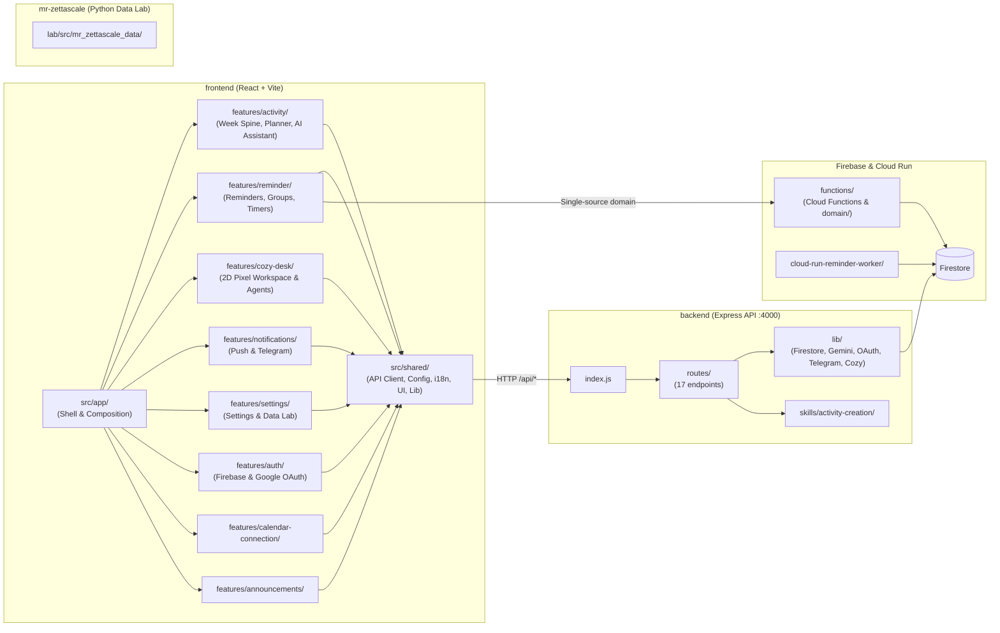

# T.i.M.E.S. — โครงสร้างภาพรวมทั้งโปรเจกต์ (Project Structure)

เอกสารนี้สรุปโครงสร้างไฟล์และโฟลเดอร์จริงของโปรเจกต์ **T.i.M.E.S.** แบบแตกกิ่งก้านสาขา เพื่อใช้ดูภาพรวมทั้งระบบ (`frontend`, `backend`, `functions`, `cloud-run-reminder-worker`, `mr-zettascale`)

---

## 1. แผนภาพสถาปัตยกรรมและทิศทางการพึ่งพา (Architecture Overview)



---

## 2. โครงสร้างแบบแตกกิ่งก้านสาขา (Full Project Tree)

```text
Directory structure:
└── arsenpual-a-times-the-calendar/                            # โฟลเดอร์ย่อย arsenpual-a-times-the-calendar/
    ├── AGENTS.md                                              # กติกาและบุคลิกของ Assistant ประจำโปรเจกต์ (MR.Zettascale)
    ├── firebase.json                                          # ค่าคอนฟิก Firebase Hosting, Functions และ Firestore
    ├── firestore.indexes.json                                 # Composite indexes ของ Firestore
    ├── firestore.rules                                        # Security rules ควบคุมสิทธิ์การอ่าน/เขียน Firestore
    ├── .firebaserc                                            # Project ID ของ Firebase
    ├── backend/                                               # Express Backend API Server (พอร์ต 4000)
    │   ├── index.js                                           # Entry point, CORS, rate limit และ route mounting
    │   ├── package.json                                       # Dependencies และ scripts ฝั่ง backend
    │   ├── .env.example                                       # ตัวอย่าง environment variables ของ backend
    │   ├── docs/                                              # คู่มือตั้งค่าฝั่ง backend
    │   │   ├── AUTO-DEPLOY.md                                 # แนวทาง auto-deploy ของ backend
    │   │   ├── Backend.md                                     # เอกสารอธิบายสถาปัตยกรรมและ API ของ backend
    │   │   ├── CALENDAR-REFRESH-TOKEN-SETUP.md                # วิธีตั้งค่า Google Calendar OAuth refresh token
    │   │   └── WEATHER-SETUP.md                               # วิธีตั้งค่า Google Weather API
    │   ├── lib/                                               # Service, database, AI และ helper modules
    │   │   ├── announcement-config.js                         # ตั้งค่าและโหลดข้อความแถบประกาศ
    │   │   ├── calendar-oauth.js                              # จัดการ Google Calendar OAuth2 & refresh token
    │   │   ├── calendar-question.js                           # ตอบคำถามเกี่ยวกับปฏิทินจาก context ที่จำกัด
    │   │   ├── cozy-desk-prompts.js                           # System instructions ของมีน่า/AI Studio/Antigravity & workspace reader
    │   │   ├── cozy-desk-sleep.js                             # Sanitizer, JSON schema และสรุปข้อมูลการนอน Cozy Desk
    │   │   ├── cozy-desk-state.js                             # สถานะตัวละครและโควต้า token รายวันของ Cozy Desk
    │   │   ├── firestore-db.js                                # ตัวเชื่อมต่อ Firestore และ collection helpers
    │   │   ├── firestore-quota.js                             # ติดตามและป้องกัน Firestore quota exhausted
    │   │   ├── gemini-api.js                                  # Client เรียก Gemini REST API และจัดการ error/model
    │   │   ├── gemini-chat.js                                 # จัดการบทสนทนา Gemini และโควต้าผู้ใช้
    │   │   ├── google-news.js                                 # ดึงข่าวจาก Google News RSS
    │   │   ├── google-weather.js                              # ดึงพยากรณ์อากาศรายชั่วโมงจาก Google Weather API
    │   │   ├── startup-task.js                                # ตัวจัดการงาน startup แบบ retry พร้อม backoff
    │   │   ├── telegram-fetch.js                              # HTTP client สำหรับ Telegram Bot API พร้อม retry
    │   │   ├── telegram-news-controller.js                    # Controller ส่งข่าวและแบ่งหน้าบน Telegram
    │   │   ├── telegram-product-questions.js                  # FAQ และข้อมูลฟีเจอร์ T.i.M.E.S. สำหรับ Telegram
    │   │   ├── telegram-weather.js                            # คำสั่งและข้อความพยากรณ์อากาศบน Telegram
    │   │   ├── telegram-webhook.js                            # รับและประมวลผล webhook updates จาก Telegram
    │   │   ├── weather-planning.js                            # คำนวณช่วงเวลาที่เหมาะสมสำหรับกิจกรรมตามสภาพอากาศ
    │   │   └── zettascale-persona.js                          # Prompt บุคลิกและโทนการตอบของ MR.Zettascale
    │   ├── middleware/                                        # โฟลเดอร์ย่อย middleware/
    │   │   └── require-auth.js                                # Middleware ตรวจ Firebase ID Token
    │   ├── routes/                                            # Express routers แยกตาม endpoint
    │   │   ├── activity-archive.js                            # API คลังกิจกรรมที่เก็บถาวร
    │   │   ├── activity-categories.js                         # API หมวดหมู่กิจกรรมหลักของ Activity Mode
    │   │   ├── activity-notifications.js                      # API แจ้งเตือนกิจกรรมผ่าน Telegram
    │   │   ├── ai-activity-draft.js                           # API ให้ AI สร้างร่างกิจกรรม
    │   │   ├── ai-weather-plan.js                             # API วางแผนกิจกรรมตามสภาพอากาศด้วย AI
    │   │   ├── announcement.js                                # API อ่าน/อัปเดตข้อความประกาศ
    │   │   ├── assistant-preferences.js                       # API ค่าความชอบของ AI Assistant
    │   │   ├── calendar-auth.js                               # API เชื่อมต่อและตัดการเชื่อมต่อ Google Calendar
    │   │   ├── calendar.js                                    # API อ่าน/สร้าง/แก้ไข/ลบ event ใน Google Calendar
    │   │   ├── categories.js                                  # API หมวดหมู่ของ Reminder Mode
    │   │   ├── cozy-desk.js                                   # API ของ Cozy Desk (ตัวละคร, แชท, สกัดข้อมูลการนอน)
    │   │   ├── data-lab-export.js                             # API export ข้อมูลสำหรับ Python Data Lab
    │   │   ├── fcm-tokens.js                                  # API ลงทะเบียน FCM token สำหรับ Web Push
    │   │   ├── reminder-groups.js                             # API จัดการกลุ่มของ Reminder
    │   │   ├── reminders.js                                   # API ซิงค์และจัดการรายการ Reminder
    │   │   └── summary.js                                     # API สรุปเวลาและสถิติรายสัปดาห์/รอบ
    │   ├── scripts/                                           # โฟลเดอร์ย่อย scripts/
    │   │   └── firestore-rules.test.js                        # สคริปต์ทดสอบ Firestore security rules
    │   ├── skills/                                            # โฟลเดอร์ย่อย skills/
    │   │   └── activity-creation/                             # ทักษะและกฎการสร้างร่างกิจกรรมของ AI
    │   │       ├── assumptions.js                             # ตรรกะเติมค่าเริ่มต้นและสมมติฐานเวลา
    │   │       ├── examples.js                                # ตัวอย่าง input/output สำหรับ AI prompt
    │   │       ├── index.js                                   # ตัวรวม pipeline ของ activity-creation skill
    │   │       ├── preferences.js                             # นำ preference ของผู้ใช้มาประกอบการสร้างร่าง
    │   │       ├── prompt.js                                  # System prompt สำหรับสร้างร่างกิจกรรม
    │   │       ├── schedule-context.js                        # จัดเตรียม context ตารางเวลาให้ AI
    │   │       ├── schema.js                                  # JSON Schema ของผลลัพธ์ร่างกิจกรรม
    │   │       ├── time-periods.js                            # ตีความช่วงเวลาภาษาไทย/อังกฤษ (เช้า, บ่าย, ค่ำ)
    │   │       └── validator.js                               # ตรวจสอบความถูกต้องของร่างกิจกรรมจาก AI
    │   └── tests/                                             # Node test runner suites (19 ไฟล์, 163 tests)
    │       ├── activity-assistant-route.integration.test.js   # ชุดทดสอบ activity-assistant-route.integration
    │       ├── activity-creation.test.js                      # ชุดทดสอบ activity-creation
    │       ├── activity-schedule-context.test.js              # ชุดทดสอบ activity-schedule-context
    │       ├── ai-weather-plan.test.js                        # ชุดทดสอบ ai-weather-plan
    │       ├── assistant-preferences.test.js                  # ชุดทดสอบ assistant-preferences
    │       ├── calendar-question.test.js                      # ชุดทดสอบ calendar-question
    │       ├── cozy-desk.test.js                              # ชุดทดสอบ cozy-desk
    │       ├── data-lab-export.test.js                        # ชุดทดสอบ data-lab-export
    │       ├── firestore-quota.test.js                        # ชุดทดสอบ firestore-quota
    │       ├── firestore-read-budget.test.js                  # ชุดทดสอบ firestore-read-budget
    │       ├── gemini-api.test.js                             # ชุดทดสอบ gemini-api
    │       ├── gemini-developer-access.test.js                # ชุดทดสอบ gemini-developer-access
    │       ├── startup-task.test.js                           # ชุดทดสอบ startup-task
    │       ├── telegram-ai-status-panel.test.js               # ชุดทดสอบ telegram-ai-status-panel
    │       ├── telegram-fetch.test.js                         # ชุดทดสอบ telegram-fetch
    │       ├── telegram-menu.test.js                          # ชุดทดสอบ telegram-menu
    │       ├── telegram-weather.test.js                       # ชุดทดสอบ telegram-weather
    │       ├── times-knowledge.test.js                        # ชุดทดสอบ times-knowledge
    │       └── zettascale-persona.test.js                     # ชุดทดสอบ zettascale-persona
    ├── cloud-run-reminder-worker/                             # Cloud Run worker สำหรับส่งแจ้งเตือนตามกำหนด
    │   ├── README.md                                          # คู่มือรันและ deploy reminder worker
    │   ├── Dockerfile                                         # Container image สำหรับ Cloud Run
    │   ├── index.js                                           # Worker ตรวจงานที่ถึงกำหนดและยิงแจ้งเตือน
    │   └── package.json                                       # Dependencies ของ worker
    ├── diagram/                                               # ไฟล์แผนภาพสถาปัตยกรรม (Mermaid/SVG/PDF)
    │   ├── diagram.mmd                                        # ซอร์สโค้ดแผนภาพ Mermaid
    │   └── mermaid.md                                         # เอกสารประกอบแผนภาพ Mermaid
    ├── docs/                                                  # เอกสารภาพรวมโปรเจกต์
    │   ├── ACTIVITY-MODE-DEEP-DIVE.md                         # เจาะลึกระบบ Activity Mode
    │   ├── DEPLOY.md                                          # คู่มือ deploy ทั้งระบบ
    │   ├── FEATURE-BASED-STRUCTURE-PLAN.md                    # แผนจัดโครงสร้างแบบ feature-based
    │   ├── firestore-quota-reduction.md                       # แนวทางลดจำนวนการอ่าน Firestore
    │   ├── FRONTEND-FEATURE-RESTRUCTURE-PLAN.md               # แผนปรับโครงสร้าง frontend
    │   ├── frontend-feature-structure.html                    # แผนภาพ HTML โครงสร้าง feature
    │   ├── GOOGLE-OAUTH-DEMO-VIDEO.md                         # สคริปต์วิดีโอเดโมสำหรับ Google OAuth review
    │   ├── GOOGLE-OAUTH-VERIFICATION-PLAN.md                  # แผนการขออนุมัติ Google OAuth verification
    │   ├── header.md                                          # สเปกและการออกแบบ Header
    │   ├── OVERVIEW.md                                        # ภาพรวมแนวคิดและฟีเจอร์ของ T.i.M.E.S.
    │   ├── REMINDER-MODE-DEEP-DIVE.md                         # เจาะลึกระบบ Reminder Mode
    │   ├── REMINDER-MODE-MIGRATION-PLAN-v2.md                 # แผน migration ของ Reminder Mode v2
    │   ├── REMINDER-TECHNICAL-DEBT.md                         # รายการ technical debt ของ Reminder Mode
    │   ├── STRUCTURE.md                                       # เอกสารโครงสร้างโฟลเดอร์โปรเจกต์
    │   └── TIMES-VISUALIZATION.md                             # แนวคิด Time-in-Action Visualization
    ├── frontend/                                              # เว็บแอพ React + Vite
    │   ├── eslint.config.js                                   # กติกา ESLint ของ frontend
    │   ├── FRONTEND-REFACTOR-BASELINE.md                      # Baseline ก่อนและหลัง refactor frontend
    │   ├── index.html                                         # HTML root template ของ Vite
    │   ├── package.json                                       # Dependencies และ scripts (dev, build, test, verify)
    │   ├── vite.config.js                                     # ตั้งค่า Vite bundler และ alias
    │   ├── .env.example                                       # ตัวอย่าง environment variables ของ frontend
    │   ├── public/                                            # โฟลเดอร์ย่อย public/
    │   │   ├── firebase-messaging-sw.js                       # Service Worker รับ Web Push notifications
    │   │   ├── googlef113841c92abc28d.html                    # ไฟล์ยืนยันสิทธิ์โดเมน Google Search Console
    │   │   ├── privacy.html                                   # หน้านโยบายความเป็นส่วนตัว (สำหรับ Google OAuth)
    │   │   ├── robots.txt                                     # กติกาการ index ของ search engine
    │   │   └── sitemap.xml                                    # แผนผังเว็บไซต์สำหรับ SEO
    │   ├── scripts/                                           # โฟลเดอร์ย่อย scripts/
    │   │   ├── generate-brand-assets.mjs                      # สคริปต์สร้างไอคอนและโลโก้แบรนด์
    │   │   └── run-tests.mjs                                  # ตัวรัน unit/integration/browser tests ทั้งหมด
    │   ├── src/                                               # โฟลเดอร์ย่อย src/
    │   │   ├── index.css                                      # CSS manifest หลักที่นำเข้าสไตล์ทุกส่วน
    │   │   ├── main.jsx                                       # Entry point mount React app ลง DOM
    │   │   ├── app/                                           # App Shell & Account Composition
    │   │   │   ├── README.md                                  # เอกสารอธิบายโครงสร้างและหน้าที่ของโฟลเดอร์นี้
    │   │   │   ├── account-app.jsx                            # ตัวประกอบหน้าหลักเมื่อผู้ใช้ล็อกอินแล้ว
    │   │   │   ├── app.jsx                                    # Root App component และจัดการสถานะ auth
    │   │   │   ├── dev-mockups.production.jsx                 # Stub ปิด mockups ใน production build
    │   │   │   ├── components/                                # โฟลเดอร์ย่อย components/
    │   │   │   │   ├── activity-auth-state.jsx                # หน้าจอสถานะการเชื่อมต่อ Google/Firebase
    │   │   │   │   ├── app-header.jsx                         # Header ด้านบน (สลับโหมด, วันที่, ชื่อสัปดาห์)
    │   │   │   │   ├── app-taskbar.jsx                        # Taskbar ด้านล่าง/ข้าง สำหรับนำทางโหมด
    │   │   │   │   └── firestore-quota-banner.jsx             # แบนเนอร์แจ้งเตือนเมื่อโควต้า Firestore ใกล้หมด
    │   │   │   ├── hooks/                                     # โฟลเดอร์ย่อย hooks/
    │   │   │   │   ├── README.md                              # เอกสารอธิบายโครงสร้างและหน้าที่ของโฟลเดอร์นี้
    │   │   │   │   ├── use-app-navigation.js                  # Hook จัดการโหมดปัจจุบันและเส้นทาง
    │   │   │   │   └── use-app-shell-ui.js                    # Hook จัดการ state UI ของ shell (drawer/modal)
    │   │   │   └── styles/                                    # โฟลเดอร์ย่อย styles/
    │   │   │       ├── app-header.css                         # สไตล์ของ AppHeader
    │   │   │       ├── app-shell.css                          # สไตล์โครงสร้างหลักของ App Shell
    │   │   │       └── app-taskbar.css                        # สไตล์ของ AppTaskbar
    │   │   ├── dev/                                           # โฟลเดอร์ย่อย dev/
    │   │   │   └── mockups/                                   # UI Mockups สำหรับ dev (แยกออกจาก production bundle)
    │   │   │       ├── README.md                              # เอกสารอธิบายโครงสร้างและหน้าที่ของโฟลเดอร์นี้
    │   │   │       ├── activity-mode-ai-workspace-mockup.css  # Dev mockup สำหรับออกแบบ/ทดสอบ UI
    │   │   │       ├── activity-mode-focus-rail-mockup.jsx    # Dev mockup สำหรับออกแบบ/ทดสอบ UI
    │   │   │       ├── activity-mode-google_design_system_dashboard-mockup.html # Dev mockup สำหรับออกแบบ/ทดสอบ UI
    │   │   │       ├── activity-mode-mini-timeline-concepts-mockup.jsx # Dev mockup สำหรับออกแบบ/ทดสอบ UI
    │   │   │       ├── activity-mode-mini-timeline-panel-braid-mockup.jsx # Dev mockup สำหรับออกแบบ/ทดสอบ UI
    │   │   │       ├── activity-mode-mini-timeline-panel-gantt-mockup.jsx # Dev mockup สำหรับออกแบบ/ทดสอบ UI
    │   │   │       ├── activity-mode-mini-timeline-panel-lanes-mockup.jsx # Dev mockup สำหรับออกแบบ/ทดสอบ UI
    │   │   │       ├── activity-mode-mini-timeline-panel-proportional-column-mockup.jsx # Dev mockup สำหรับออกแบบ/ทดสอบ UI
    │   │   │       ├── activity-mode-mockup-preview.jsx       # Dev mockup สำหรับออกแบบ/ทดสอบ UI
    │   │   │       ├── activity-mode-mockup-support.css       # Dev mockup สำหรับออกแบบ/ทดสอบ UI
    │   │   │       ├── activity-mode-reminder-mode-reminder-dashboard-mockup.jsx # Dev mockup สำหรับออกแบบ/ทดสอบ UI
    │   │   │       ├── activity-mode-seven-day-focus-mockup.jsx # Dev mockup สำหรับออกแบบ/ทดสอบ UI
    │   │   │       ├── activity-mode-streamgraph-section-mockup.jsx # Dev mockup สำหรับออกแบบ/ทดสอบ UI
    │   │   │       ├── activity-mode-summary-hero-mockup.jsx  # Dev mockup สำหรับออกแบบ/ทดสอบ UI
    │   │   │       ├── activity-mode-week-nav-bar-mockup.css  # Dev mockup สำหรับออกแบบ/ทดสอบ UI
    │   │   │       ├── activity-mode-week-nav-bar-mockup.jsx  # Dev mockup สำหรับออกแบบ/ทดสอบ UI
    │   │   │       ├── activity-mode-week-spine-mockup.jsx    # Dev mockup สำหรับออกแบบ/ทดสอบ UI
    │   │   │       ├── AI-MODE-DEVELOPMENT-PLAN.md            # แผนพัฒนา UI ของ AI Mode
    │   │   │       ├── AI-MODE-MOCKUP-BRIEF.md                # บรีฟออกแบบ mockup ของ AI Mode
    │   │   │       ├── dev-mockups-entry.jsx                  # Entry point รวมหน้า preview mockups
    │   │   │       ├── new calendar 7 day focus/              # Dev mockup สำหรับออกแบบ/ทดสอบ UI
    │   │   │       │   ├── README.md                          # เอกสารอธิบายโครงสร้างและหน้าที่ของโฟลเดอร์นี้
    │   │   │       │   ├── Main.dc.html                       # Dev mockup สำหรับออกแบบ/ทดสอบ UI
    │   │   │       │   └── support.js                         # Dev mockup สำหรับออกแบบ/ทดสอบ UI
    │   │   │       └── summary-hero/                          # Dev mockup สำหรับออกแบบ/ทดสอบ UI
    │   │   │           ├── README.md                          # เอกสารอธิบายโครงสร้างและหน้าที่ของโฟลเดอร์นี้
    │   │   │           ├── ConceptA.dc.html                   # Dev mockup สำหรับออกแบบ/ทดสอบ UI
    │   │   │           └── support.js                         # Dev mockup สำหรับออกแบบ/ทดสอบ UI
    │   │   ├── features/                                      # โฟลเดอร์ย่อย features/
    │   │   │   ├── activity/                                  # โหมด Activity & ปฏิทินเวลา
    │   │   │   │   ├── README.md                              # เอกสารอธิบายโครงสร้างและหน้าที่ของโฟลเดอร์นี้
    │   │   │   │   ├── api/                                   # โฟลเดอร์ย่อย api/
    │   │   │   │   │   ├── README.md                          # เอกสารอธิบายโครงสร้างและหน้าที่ของโฟลเดอร์นี้
    │   │   │   │   │   ├── archive.js                         # API อ่าน/บันทึกคลังกิจกรรม
    │   │   │   │   │   ├── categories.js                      # API หมวดหมู่กิจกรรม
    │   │   │   │   │   ├── locks.js                           # API จัดการการล็อกหมวดหมู่/กิจกรรม
    │   │   │   │   │   ├── notifications.js                   # API ตั้งค่าแจ้งเตือนกิจกรรม
    │   │   │   │   │   ├── summary.js                         # API ดึงสรุปเวลารายสัปดาห์และรอบ
    │   │   │   │   │   └── tags.js                            # API ค้นหาและจัดการแท็กกิจกรรม
    │   │   │   │   ├── assistant/                             # Sub-feature ผู้ช่วย AI (MR.Zettascale)
    │   │   │   │   │   ├── README.md                          # เอกสารอธิบายโครงสร้างและหน้าที่ของโฟลเดอร์นี้
    │   │   │   │   │   ├── AI-MODE-BEHAVIOR-CONTRACT.md       # ข้อกำหนดพฤติกรรมและขอบเขตของ AI Assistant
    │   │   │   │   │   ├── api/                               # โฟลเดอร์ย่อย api/
    │   │   │   │   │   │   ├── activity-assistant-api.js      # API สื่อสารกับ AI Assistant ฝั่ง backend
    │   │   │   │   │   │   └── assistant-preferences-api.js   # API บันทึก/อ่าน preference ของผู้ช่วย
    │   │   │   │   │   ├── components/                        # โฟลเดอร์ย่อย components/
    │   │   │   │   │   │   ├── activity-assistant-dialog.jsx  # หน้าต่างแชทผู้ช่วย AI หลัก
    │   │   │   │   │   │   ├── assistant-composer.jsx         # ช่องพิมพ์คำสั่งและส่งข้อความให้ AI
    │   │   │   │   │   │   ├── assistant-header.jsx           # ส่วนหัวหน้าต่างผู้ช่วยและสถานะโควต้า
    │   │   │   │   │   │   ├── assistant-transcript.jsx       # รายการข้อความแชทและการ์ดร่างกิจกรรม
    │   │   │   │   │   │   └── assistant-work-rail.jsx        # แถบเครื่องมือ/ขั้นตอนการทำงานแบบ guided rail
    │   │   │   │   │   ├── config/                            # โฟลเดอร์ย่อย config/
    │   │   │   │   │   │   └── activity-assistant-conversation-tree.js # โครงสร้างคำถามนำทางแบบ deterministic
    │   │   │   │   │   ├── hooks/                             # โฟลเดอร์ย่อย hooks/
    │   │   │   │   │   │   ├── use-activity-assistant-conversation.js # Hook หลักคุม flow การสนทนากับ AI
    │   │   │   │   │   │   ├── use-assistant-activity-actions.js # Hook เชื่อม action จากแชทเข้ากับ Activity workspace
    │   │   │   │   │   │   ├── use-assistant-chat-storage.js  # Hook เก็บประวัติแชทแยกตามบัญชีผู้ใช้
    │   │   │   │   │   │   └── use-assistant-preferences.js   # Hook โหลดและอัปเดต preference ของผู้ช่วย
    │   │   │   │   │   ├── lib/                               # โฟลเดอร์ย่อย lib/
    │   │   │   │   │   │   ├── activity-popup-handoff.js      # ส่งต่อร่างกิจกรรมที่พร้อมแล้วไปยัง ActivityPopup
    │   │   │   │   │   │   ├── activity-schedule-context.js   # สร้างบริบทตารางเวลาส่งให้ AI
    │   │   │   │   │   │   ├── assistant-source-label.js      # ป้ายระบุแหล่งที่มาของคำตอบ (AI / Calendar / Planner)
    │   │   │   │   │   │   ├── daily-summary-chat.js          # สร้างสรุปกิจกรรมรายวันในแชท
    │   │   │   │   │   │   ├── guided-activity-validation.js  # ตรวจสอบความครบถ้วนของร่างใน guided rail
    │   │   │   │   │   │   ├── preference-corrections.js      # ตรวจจับการแก้ไขของผู้ใช้เพื่อเรียนรู้ preference
    │   │   │   │   │   │   ├── schedule-format.js             # จัดรูปแบบเวลาและช่วงเวลาในแชท
    │   │   │   │   │   │   ├── validate-plan-draft.js         # ตรวจสอบความถูกต้องของร่างแผนงานที่แก้ไข
    │   │   │   │   │   │   └── weather-slot-validation.js     # ตรวจซ้ำสภาพอากาศก่อนบันทึกร่างกิจกรรม
    │   │   │   │   │   └── tests/                             # Unit tests ของ AI Assistant (6 ไฟล์)
    │   │   │   │   │       ├── activity-popup-handoff.test.mjs # Unit test: activity-popup-handoff
    │   │   │   │   │       ├── assistant-boundaries.test.mjs  # Unit test: assistant-boundaries
    │   │   │   │   │       ├── assistant-source-label.test.mjs # Unit test: assistant-source-label
    │   │   │   │   │       ├── guided-activity-validation.test.mjs # Unit test: guided-activity-validation
    │   │   │   │   │       ├── validate-plan-draft.test.mjs   # Unit test: validate-plan-draft
    │   │   │   │   │       └── weather-slot-validation.test.mjs # Unit test: weather-slot-validation
    │   │   │   │   ├── components/                            # โฟลเดอร์ย่อย components/
    │   │   │   │   │   ├── activity-daily-planner.jsx         # มุมมองวางแผนรายวันแบบ timeline
    │   │   │   │   │   ├── activity-day-gantt.jsx             # กราฟแท่ง Gantt ของกิจกรรมในหนึ่งวัน
    │   │   │   │   │   ├── activity-modal-sections.jsx        # ส่วนประกอบย่อยในฟอร์มแก้ไขกิจกรรม
    │   │   │   │   │   ├── activity-modal.jsx                 # Modal สร้าง/แก้ไขกิจกรรม
    │   │   │   │   │   ├── activity-mode-week-spine.jsx       # มุมมอง Week Spine 7 วัน
    │   │   │   │   │   ├── activity-popup-sections.jsx        # ส่วนประกอบย่อยในหน้าต่างดูรายละเอียดกิจกรรม
    │   │   │   │   │   ├── activity-popup.jsx                 # Popup แสดงรายละเอียด/ลบ/ย้ายกิจกรรม
    │   │   │   │   │   ├── activity-summary-hero.jsx          # การ์ดสรุปเด่น (Summary Hero) ของรอบเวลา
    │   │   │   │   │   ├── activity-time-streamgraph.jsx      # กราฟ Streamgraph แสดงสัดส่วนเวลา
    │   │   │   │   │   ├── cycle-summary-panel.jsx            # แผงสรุปข้อมูลระดับ Cycle
    │   │   │   │   │   ├── four-week-overview.jsx             # มุมมองภาพรวม 4 สัปดาห์ (Lonth)
    │   │   │   │   │   ├── header-summary.jsx                 # แถบสรุปสถิติสั้นๆ บน Header
    │   │   │   │   │   ├── lonth-nav-bar.jsx                  # แถบนำทางระดับ Lonth
    │   │   │   │   │   ├── mini-timeline-panel.jsx            # แผง mini timeline ด้านข้าง
    │   │   │   │   │   ├── month-nav-bar.jsx                  # แถบนำทางระดับเดือน
    │   │   │   │   │   ├── planner-time-actions.jsx           # ปุ่มจัดการเวลาด่วนใน Daily Planner
    │   │   │   │   │   ├── tag-search-results.jsx             # แสดงผลลัพธ์การค้นหากิจกรรมตามแท็ก
    │   │   │   │   │   ├── week-name-field.jsx                # ช่องแก้ชื่อสัปดาห์บน Header
    │   │   │   │   │   ├── week-nav-bar.jsx                   # แถบนำทางระดับสัปดาห์
    │   │   │   │   │   └── weekly-summary-panel.jsx           # แผงสรุปสถิติรายสัปดาห์
    │   │   │   │   ├── hooks/                                 # โฟลเดอร์ย่อย hooks/
    │   │   │   │   │   ├── README.md                          # เอกสารอธิบายโครงสร้างและหน้าที่ของโฟลเดอร์นี้
    │   │   │   │   │   ├── use-activity-archive-calendar-actions.js # จัดการนำเข้า/ซิงค์คลังกิจกรรมกับปฏิทิน
    │   │   │   │   │   ├── use-activity-archive-editor.js     # แก้ไขรายการในคลังกิจกรรม
    │   │   │   │   │   ├── use-activity-archive-state.js      # State ของคลังกิจกรรม
    │   │   │   │   │   ├── use-activity-archive-sync.js       # ซิงค์คลังกิจกรรมกับ backend/Firestore
    │   │   │   │   │   ├── use-activity-archive.js            # Hook หลักรวมความสามารถของคลังกิจกรรม
    │   │   │   │   │   ├── use-activity-collections.js        # โหลดหมวดหมู่, แท็ก และ lock ของกิจกรรม
    │   │   │   │   │   ├── use-activity-error.js              # จัดการข้อความ error ของ Activity Mode
    │   │   │   │   │   ├── use-activity-modal.js              # คุมการเปิด/ปิดและค่าเริ่มต้นของ ActivityModal
    │   │   │   │   │   ├── use-activity-mutations.js          # Action สร้าง/แก้/ลบ/ย้ายกิจกรรม
    │   │   │   │   │   ├── use-activity-onboarding.js         # จัดการสถานะ onboarding ผู้ใช้ใหม่
    │   │   │   │   │   ├── use-activity-view.js               # สลับมุมมอง week / month / lonth / day
    │   │   │   │   │   ├── use-activity-workspace.js          # Hook ประสานงานหลักของ Activity Mode
    │   │   │   │   │   ├── use-archived-activity-ids.js       # ติดตาม ID กิจกรรมที่ถูกเก็บเข้าคลังแล้ว
    │   │   │   │   │   ├── use-calendar-data.js               # โหลดและ cache ข้อมูลปฏิทินตามสัปดาห์
    │   │   │   │   │   ├── use-cycle-activities.js            # ดึงข้อมูลกิจกรรมทั้ง Cycle เพื่อคำนวณสถิติ
    │   │   │   │   │   ├── use-planner-drag.js                # รองรับการลากวางเวลาใน Daily Planner
    │   │   │   │   │   ├── use-tag-search.js                  # ค้นหากิจกรรมตามแท็กแบบยกเลิกคำขอเก่าได้
    │   │   │   │   │   ├── use-week-names.js                  # โหลดและบันทึกชื่อสัปดาห์
    │   │   │   │   │   ├── use-week-navigation.js             # เลื่อนดูสัปดาห์/เดือน/Lonth ก่อนหน้า-ถัดไป
    │   │   │   │   │   ├── use-week-spine-drag-controller.js  # Controller ลากย้าย/ยืดเวลาบน Week Spine
    │   │   │   │   │   ├── use-week-spine-drag-state.js       # State ขณะกำลังลากกิจกรรมบน Week Spine
    │   │   │   │   │   ├── use-week-spine-selection.js        # จัดการรายการที่ถูกเลือกบน Week Spine
    │   │   │   │   │   ├── use-week-spine-time-changes.js     # คำนวณและบันทึกการเปลี่ยนเวลาหลังลาก
    │   │   │   │   │   └── use-week-spine-ui-state.js         # UI state ของ Week Spine
    │   │   │   │   ├── lib/                                   # โฟลเดอร์ย่อย lib/
    │   │   │   │   │   ├── activity-modal-logic.js            # ตรรกะคำนวณวันที่/ข้ามคืน/repeat ของ Modal
    │   │   │   │   │   ├── activity-modal-logic.test.mjs              # Unit test ของ activity-modal-logic
    │   │   │   │   │   ├── activity-mutation-logic.js         # ตรรกะตรวจสอบการซ้อนทับและสร้าง payload
    │   │   │   │   │   ├── activity-mutation-logic.test.mjs           # Unit test ของ activity-mutation-logic
    │   │   │   │   │   ├── activity-popup-actions.js          # ตัวช่วยจัดการ action ใน Popup
    │   │   │   │   │   ├── activity-popup-logic.js            # จัดรูปแบบข้อมูลและเตือนการแก้ recurring series
    │   │   │   │   │   ├── activity-popup-logic.test.mjs              # Unit test ของ activity-popup-logic
    │   │   │   │   │   ├── daily-planner-layout.js            # คำนวณตำแหน่งคอลัมน์เมื่อกิจกรรมซ้อนทับ
    │   │   │   │   │   ├── export-day-image.js                # Export ตารางวันเป็นรูปภาพ PNG
    │   │   │   │   │   ├── planner-time-draft.js              # จัดการร่างเวลาขณะลากใน Planner
    │   │   │   │   │   ├── rrule-utils.js                     # แปลงและจัดการกฎการเกิดซ้ำ (RRULE)
    │   │   │   │   │   ├── week-spine-data.js                 # จัดเตรียมข้อมูลกิจกรรมสำหรับ Week Spine
    │   │   │   │   │   └── week-spine-time-changes.js         # ตัวช่วยคำนวณเวลาใหม่ของ Week Spine
    │   │   │   │   ├── services/                              # โฟลเดอร์ย่อย services/
    │   │   │   │   │   ├── activity-calendar-actions.js       # Service เรียก API บันทึก/แก้/ลบลงปฏิทิน
    │   │   │   │   │   ├── activity-calendar-actions.test.mjs         # Unit test ของ activity-calendar-actions
    │   │   │   │   │   ├── activity-metadata-actions.js       # Service จัดการหมวดหมู่ แท็ก และ lock
    │   │   │   │   │   └── activity-metadata-actions.test.mjs         # Unit test ของ activity-metadata-actions
    │   │   │   │   └── styles/                                # โฟลเดอร์ย่อย styles/
    │   │   │   │       ├── activity-assistant.css             # สไตล์ CSS ของ activity-assistant
    │   │   │   │       ├── activity-daily-planner.css         # สไตล์ CSS ของ activity-daily-planner
    │   │   │   │       ├── activity-mini-timeline.css         # สไตล์ CSS ของ activity-mini-timeline
    │   │   │   │       ├── activity-modal-fields.css          # สไตล์ CSS ของ activity-modal-fields
    │   │   │   │       ├── activity-modal.css                 # สไตล์ CSS ของ activity-modal
    │   │   │   │       ├── activity-mode.css                  # สไตล์ CSS ของ activity-mode
    │   │   │   │       ├── activity-popup.css                 # สไตล์ CSS ของ activity-popup
    │   │   │   │       ├── activity-summaries.css             # สไตล์ CSS ของ activity-summaries
    │   │   │   │       ├── activity-timeline-editor.css       # สไตล์ CSS ของ activity-timeline-editor
    │   │   │   │       ├── activity-workspace.css             # สไตล์ CSS ของ activity-workspace
    │   │   │   │       └── mini-timeline-panel.css            # สไตล์ CSS ของ mini-timeline-panel
    │   │   │   ├── announcements/                             # แถบข่าวประกาศด้านบนของแอพ
    │   │   │   │   ├── README.md                              # เอกสารอธิบายโครงสร้างและหน้าที่ของโฟลเดอร์นี้
    │   │   │   │   ├── api/                                   # โฟลเดอร์ย่อย api/
    │   │   │   │   │   └── announcement.js                    # API ดึงข้อความประกาศล่าสุด
    │   │   │   │   ├── components/                            # โฟลเดอร์ย่อย components/
    │   │   │   │   │   └── announcement-ticker.jsx            # Component แสดงข้อความวิ่งประกาศ
    │   │   │   │   ├── hooks/                                 # โฟลเดอร์ย่อย hooks/
    │   │   │   │   │   └── use-announcement-message.js        # Hook โหลดและรีเฟรชประกาศ
    │   │   │   │   └── styles/                                # โฟลเดอร์ย่อย styles/
    │   │   │   │       └── announcement-ticker.css            # สไตล์ CSS ของ announcement-ticker
    │   │   │   ├── auth/                                      # ระบบเข้าสู่ระบบ Firebase และ Google OAuth
    │   │   │   │   ├── README.md                              # เอกสารอธิบายโครงสร้างและหน้าที่ของโฟลเดอร์นี้
    │   │   │   │   ├── api/                                   # โฟลเดอร์ย่อย api/
    │   │   │   │   │   └── google-auth.js                     # Wrapper สำหรับ Firebase Google Sign-In
    │   │   │   │   ├── hooks/                                 # โฟลเดอร์ย่อย hooks/
    │   │   │   │   │   └── use-auth.js                        # Hook จัดการ session ผู้ใช้และสิทธิ์ Calendar
    │   │   │   │   └── styles/                                # โฟลเดอร์ย่อย styles/
    │   │   │   │       └── auth.css                           # สไตล์ CSS ของ auth
    │   │   │   ├── calendar-connection/                       # หน้าจอเชื่อมต่อ/ต่ออายุ Google Calendar
    │   │   │   │   ├── README.md                              # เอกสารอธิบายโครงสร้างและหน้าที่ของโฟลเดอร์นี้
    │   │   │   │   ├── components/                            # โฟลเดอร์ย่อย components/
    │   │   │   │   │   └── calendar-connection-overlays.jsx   # Modal แจ้งเตือนเมื่อต้องเชื่อมต่อ Calendar ใหม่
    │   │   │   │   └── styles/                                # โฟลเดอร์ย่อย styles/
    │   │   │   │       └── calendar-connection.css            # สไตล์ CSS ของ calendar-connection
    │   │   │   ├── cozy-desk/                                 # โหมด 2D Pixel Interactive Workspace (ทุกไฟล์ ≤ 800 บรรทัด)
    │   │   │   │   ├── README.md                              # เอกสารอธิบายโครงสร้างและหน้าที่ของโฟลเดอร์นี้
    │   │   │   │   ├── cozy-desk-mode.jsx                     # Lazy boundary ที่คงสถานะเมื่อสลับไปโหมดอื่น
    │   │   │   │   ├── CozyDeskApp.tsx                        # ตัวประสานงานหลักของ Cozy Desk
    │   │   │   │   ├── api/                                   # โฟลเดอร์ย่อย api/
    │   │   │   │   │   ├── cozyApi.ts                         # Fetch wrapper เชื่อม /api/cozy-desk พร้อม Firebase token
    │   │   │   │   │   ├── driveApi.ts                        # เชื่อมต่อ Google Drive API (อ่าน/ค้นหา/บันทึกไฟล์)
    │   │   │   │   │   ├── gmailApi.ts                        # เชื่อมต่อ Gmail API (เช็คข้อความใหม่/อ่านเมล)
    │   │   │   │   │   ├── sleepLogsApi.ts                    # จัดการบันทึกการนอน (.json) และสกัดข้อมูลจากภาพ
    │   │   │   │   │   ├── tasksApi.ts                        # เชื่อมต่อ Google Tasks API (lists & tasks CRUD)
    │   │   │   │   │   ├── youtubeApi.ts                      # ดึงฟีด, เพลย์ลิสต์ และค้นหาวิดีโอ YouTube
    │   │   │   │   │   └── youtubeAuth.ts                     # จัดการ Google OAuth token สำหรับ Workspace APIs
    │   │   │   │   ├── components/                            # โฟลเดอร์ย่อย components/
    │   │   │   │   │   ├── AiStudioModal.tsx                  # หน้าต่างเวิร์กเบนช์ตัวละคร Google AI Studio
    │   │   │   │   │   ├── AiStudioSubsections.tsx            # ส่วนแสดงผลแชทและค่าเริ่มต้นของ AI Studio
    │   │   │   │   │   ├── AntigravityModal.tsx               # หน้าต่างคอนโซลตัวละคร Antigravity Localhost Agent
    │   │   │   │   │   ├── AntigravitySubsections.tsx         # ส่วนแสดงผลแชทและค่าเริ่มต้นของ Antigravity
    │   │   │   │   │   ├── CozyModalsLayer.tsx                # เลเยอร์รวม Modal ทั้ง 8 ตัวของ Cozy Desk
    │   │   │   │   │   ├── CozyViewportChrome.tsx             # แถบเครื่องมือกล้อง, ปุ่มล่าง, และ overlay เต็มจอ
    │   │   │   │   │   ├── DriveTableModal.tsx                # หน้าต่างเปิดดูไฟล์จากโต๊ะเอกสาร Google Drive
    │   │   │   │   │   ├── GameCanvas.tsx                     # Canvas 2D หลักคุม game loop และการเรนเดอร์
    │   │   │   │   │   ├── MailboxModal.tsx                   # หน้าต่างตู้ไปรษณีย์อ่าน Gmail
    │   │   │   │   │   ├── SaveToDriveModal.tsx               # Modal แปลงและบันทึกผลลัพธ์ลง Google Docs/Sheets/MD
    │   │   │   │   │   ├── SleepDriveImagePicker.tsx          # ตัวเลือกรูปภาพสถิติการนอนจาก Google Drive
    │   │   │   │   │   ├── SleepQuestModal.tsx                # หน้าต่างภารกิจบันทึกการนอนประจำวัน (.json)
    │   │   │   │   │   ├── SleepQuestSubsections.tsx          # ฟอร์มแก้ไขข้อมูลการนอนและคลังประวัติ .json
    │   │   │   │   │   ├── TasksPinboardModal.tsx             # กระดานโน้ต Google Tasks และสั่งงาน AI ตามเวลา
    │   │   │   │   │   ├── TasksPinboardSubsections.tsx       # การ์ดงาน, ฟอร์มตัวเลือก, และกล่องยืนยันของ Pinboard
    │   │   │   │   │   ├── TitleScreen.tsx                    # หน้าจอเริ่มเกม Cozy Desk
    │   │   │   │   │   ├── TopHud.tsx                         # HUD ด้านบน (โซนห้อง, เวลา, ภารกิจประจำวัน)
    │   │   │   │   │   ├── TvModal.tsx                        # หน้าต่างทีวี YouTube ในห้องนั่งเล่น
    │   │   │   │   │   ├── TvModalSubsections.tsx             # ตารางฟีดวิดีโอและหน้าจอรับชมของ TvModal
    │   │   │   │   │   ├── WorkspacePanel.tsx                 # แผงแชทและคลังฉบับร่างร่วมกับผู้ช่วยมีน่า
    │   │   │   │   │   └── WorkspaceSubcomponents.tsx         # การ์ดยืนยันเพิ่มงานและตัวเรนเดอร์ Markdown
    │   │   │   │   ├── game/                                  # โฟลเดอร์ย่อย game/
    │   │   │   │   │   ├── bathroomRenderer.ts                # วาดเฟอร์นิเจอร์ห้องน้ำและตู้อาบน้ำกระจกฝ้า
    │   │   │   │   │   ├── cameraAndProximity.ts              # คำนวณกล้อง, zoom, พิกัดจอ-โลก และระยะเข้าใกล้ NPC
    │   │   │   │   │   ├── canvasPointerController.ts         # จัดการเมาส์/สัมผัส (ลากแมพ, ซูม, คลิกเดิน/โต้ตอบ)
    │   │   │   │   │   ├── characterRenderer.ts               # วาดตัวละครผู้เล่น, มีน่า, Antigravity, AI Studio และ speech bubble
    │   │   │   │   │   ├── gameLoopStep.ts                    # อัปเดต 1 frame ของเกม (การเดิน, รถ, HUD, hover)
    │   │   │   │   │   ├── houseCollisionAndInteractables.ts  # พิกัดวัตถุโต้ตอบ (INTERACTABLES), ชนกำแพง, และฟิสิกส์รถ
    │   │   │   │   │   ├── houseLayout.ts                     # ค่าคงที่แผนที่, พิกัดห้อง, และ colliders ฐาน
    │   │   │   │   │   ├── houseMap.ts                        # Barrel file รวม export จาก houseLayout และ collision
    │   │   │   │   │   ├── inspectableObjects.ts              # รายการวัตถุที่ชี้ค้างเพื่อดูคำอธิบายได้
    │   │   │   │   │   ├── lowerRoomsRenderer.ts              # วาดพื้น, ผนัง และเฟอร์นิเจอร์ห้องครัว/ห้องน้ำ
    │   │   │   │   │   ├── minaNpcSimulation.ts               # AI การเดิน, ปักหมุดงาน, และเดินมาส่งงานของมีน่า
    │   │   │   │   │   ├── pathfinding.ts                     # อัลกอริทึม A* หาเส้นทางเดินในบ้าน
    │   │   │   │   │   ├── pixelRenderer.ts                   # ตัวประสานการวาดฉากบ้านทั้งหมดลง Canvas
    │   │   │   │   │   ├── simulationStep.ts                  # ซิมูเลชันอาบน้ำอัตโนมัติ, ขับรถ และ NPC เดินส่งงาน
    │   │   │   │   │   ├── southBadgesAndMailboxRenderer.ts   # วาดตู้ไปรษณีย์, แบดจ์ภารกิจ และความมืดห้องนอน
    │   │   │   │   │   ├── southExteriorAndPropsRenderer.ts   # วาดรถสีเขียว, อุปกรณ์ยิม และระเบียงหน้าบ้าน
    │   │   │   │   │   ├── southRoomsRenderer.ts              # วาดพื้นสนามหญ้า, ห้องยิม, โรงรถ และถนน
    │   │   │   │   │   ├── southWallsRenderer.ts              # วาดผนังโถงทางเข้า, ยิม, โรงรถ และรั้วหน้าบ้าน
    │   │   │   │   │   ├── upperRoomsArchitectureRenderer.ts  # วาดพื้นและผนังห้องนั่งเล่นกับห้องทำงาน
    │   │   │   │   │   ├── upperRoomsFurnitureRenderer.ts     # วาดเฟอร์นิเจอร์ห้องนั่งเล่นและห้องทำงาน
    │   │   │   │   │   └── westBedroomRenderer.ts             # วาดห้องนอนใหญ่ฝั่งตะวันตก, ต้นไม้ และพุ่มไม้
    │   │   │   │   ├── hooks/                                 # โฟลเดอร์ย่อย hooks/
    │   │   │   │   │   ├── useCanvasCommandEffects.ts         # Hook ตอบสนองคำสั่งกล้อง, ปักหมุด และเรียกมีน่า
    │   │   │   │   │   ├── useCozyAssistantStreaming.ts       # Hook คุมแชทสตรีมกับมีน่า, Gmail และ Tasks summary
    │   │   │   │   │   ├── useCozyQuestsAndStatuses.ts        # Hook คุมภารกิจประจำวัน (นอน/รดน้ำ) และสถานะ NPC
    │   │   │   │   │   ├── useCozyTaskDeliveryAndScheduler.ts # Hook ตรวจงานถึงกำหนดและให้ NPC เดินมาส่งผลในแชท
    │   │   │   │   │   └── useCozyWorldInteractions.ts        # Hook จัดการการคลิกโต้ตอบวัตถุ, เต็มจอ และ Google Auth
    │   │   │   │   ├── lib/                                   # โฟลเดอร์ย่อย lib/
    │   │   │   │   │   ├── cozyDeskDefaults.ts                # ค่าเริ่มต้นฟีดทีวี, ทิปชั้นหนังสือ และ localStorage helpers
    │   │   │   │   │   ├── driveExport.ts                     # ตัวช่วยแปลงข้อความเป็นไฟล์ส่งขึ้น Google Drive
    │   │   │   │   │   ├── minaTaskScheduler.ts               # Parser/formatter สำหรับตั้งเวลาสั่งงาน AI ใน Google Tasks
    │   │   │   │   │   ├── plantQuestStorage.ts               # เก็บประวัติการรดน้ำต้นไม้ 5 ต้นประจำวัน
    │   │   │   │   │   └── sound.ts                           # Web Audio synthesizer สร้างเสียงประกอบแบบ retro pixel
    │   │   │   │   └── types/                                 # โฟลเดอร์ย่อย types/
    │   │   │   │       └── game.ts                            # TypeScript interfaces ของระบบเกมและ API ทั้งหมด
    │   │   │   ├── notifications/                             # ระบบแจ้งเตือน Web Push และ Telegram
    │   │   │   │   ├── README.md                              # เอกสารอธิบายโครงสร้างและหน้าที่ของโฟลเดอร์นี้
    │   │   │   │   ├── api/                                   # โฟลเดอร์ย่อย api/
    │   │   │   │   │   ├── push-api.js                        # API ลงทะเบียนและทดสอบ FCM Web Push
    │   │   │   │   │   ├── telegram-api.js                    # API เชื่อมต่อบัญชีและตั้งค่าแจ้งเตือน Telegram
    │   │   │   │   │   └── telegram-chat-api.js               # API แชทกับบอต Telegram ผ่านหน้าเว็บ
    │   │   │   │   ├── components/                            # โฟลเดอร์ย่อย components/
    │   │   │   │   │   ├── telegram-chat-launcher.jsx         # ปุ่มลอยและหน้าต่างแชท Telegram บนเว็บ
    │   │   │   │   │   └── telegram-connection-toast.jsx      # Toast แจ้งเตือนสถานะการเชื่อม Telegram
    │   │   │   │   ├── hooks/                                 # โฟลเดอร์ย่อย hooks/
    │   │   │   │   │   ├── use-activity-telegram-notifications.js # Hook ตั้งค่าแจ้งเตือนกิจกรรมเข้า Telegram
    │   │   │   │   │   ├── use-push-notifications.js          # Hook ขออนุญาตและจัดการ Web Push
    │   │   │   │   │   ├── use-telegram-connection.js         # Hook จัดการสถานะเชื่อมต่อ Telegram
    │   │   │   │   │   └── use-telegram-web-chat.js           # Hook ซิงค์และส่งข้อความใน Telegram web chat
    │   │   │   │   └── lib/                                   # โฟลเดอร์ย่อย lib/
    │   │   │   │       └── telegram-notification-preferences.js # ค่าเริ่มต้นและตัวช่วย preference ของ Telegram
    │   │   │   ├── reminder/                                  # โหมด Reminder (รายการเตือนความจำ, กลุ่ม, ตัวจับเวลา)
    │   │   │   │   ├── README.md                              # เอกสารอธิบายโครงสร้างและหน้าที่ของโฟลเดอร์นี้
    │   │   │   │   ├── api/                                   # โฟลเดอร์ย่อย api/
    │   │   │   │   │   ├── README.md                          # เอกสารอธิบายโครงสร้างและหน้าที่ของโฟลเดอร์นี้
    │   │   │   │   │   ├── groups.js                          # API จัดการกลุ่มของ Reminder
    │   │   │   │   │   └── reminders.js                       # API ซิงค์และ CRUD รายการ Reminder
    │   │   │   │   ├── components/                            # โฟลเดอร์ย่อย components/
    │   │   │   │   │   ├── reminder-alerts.jsx                # แบนเนอร์/Popup แจ้งเตือนเมื่อถึงกำหนด
    │   │   │   │   │   ├── reminder-card.jsx                  # การ์ดแสดงรายการ Reminder แต่ละชิ้น
    │   │   │   │   │   ├── reminder-composer.jsx              # ฟอร์มสร้าง/แก้ไข Reminder พร้อม quick parse
    │   │   │   │   │   ├── reminder-list-panel.jsx            # แผงแสดงรายการ Reminder ตามตัวกรอง
    │   │   │   │   │   ├── reminder-mode.jsx                  # Component หลักของ Reminder Mode
    │   │   │   │   │   ├── reminder-sidebar.jsx               # แถบข้างเลือกกลุ่มและตัวกรองของ Reminder
    │   │   │   │   │   ├── reminder-stats-panel.jsx           # แผงสถิติการทำงาน/ความสำเร็จของ Reminder
    │   │   │   │   │   ├── reminder-timeline-panel.jsx        # แผง Timeline แสดงงานตามช่วงเวลา
    │   │   │   │   │   ├── reminder-timeline-rows.jsx         # แถวรายการภายใน Reminder Timeline
    │   │   │   │   │   └── reminder-topbar.jsx                # แถบเครื่องมือด้านบนของ Reminder Mode
    │   │   │   │   ├── hooks/                                 # โฟลเดอร์ย่อย hooks/
    │   │   │   │   │   ├── reminder-timeline-export.test.mjs  # Unit test ของ timeline และการ export รูป
    │   │   │   │   │   ├── use-activity-context-menu.js       # Context menu สำหรับคลิกขวาจัดการรายการ
    │   │   │   │   │   ├── use-due-reminders.js               # ตรวจจับรายการที่ถึงกำหนดแจ้งเตือน
    │   │   │   │   │   ├── use-event-anchor-sessions.js       # จัดการ session การจับเวลาที่ผูกกับ event
    │   │   │   │   │   ├── use-reminder-actions.js            # Action ติ๊กเสร็จ, ข้าม, จับเวลา, และลบ
    │   │   │   │   │   ├── use-reminder-calendar.js           # ดึงข้อมูล event ปฏิทินมาแสดงประกอบ Reminder
    │   │   │   │   │   ├── use-reminder-composer-actions.js   # Action บันทึกร่างจาก Composer
    │   │   │   │   │   ├── use-reminder-composer-preview.js   # Preview รอบเวลาถัดไปใน Composer
    │   │   │   │   │   ├── use-reminder-composer-state.js     # State ของฟอร์ม Reminder Composer
    │   │   │   │   │   ├── use-reminder-export.js             # Export ตาราง Reminder เป็นรูปภาพ
    │   │   │   │   │   ├── use-reminder-filters.js            # ตัวกรองสถานะ, กลุ่ม และคำค้นหา
    │   │   │   │   │   ├── use-reminder-groups.js             # โหลดและจัดการกลุ่มของ Reminder
    │   │   │   │   │   ├── use-reminder-menus.js              # จัดการเมนูย่อยและ popover ใน Reminder
    │   │   │   │   │   ├── use-reminder-omnibar.js            # ช่องค้นหา/เพิ่มด่วนแบบ Omnibar
    │   │   │   │   │   ├── use-reminder-stats.js              # คำนวณสถิติจากรายการ Reminder
    │   │   │   │   │   ├── use-reminder-store.js              # State กลางและการอัปเดตแบบ optimistic
    │   │   │   │   │   ├── use-reminder-timeline.js           # คำนวณช่วงเวลาและ zoom ของ Reminder Timeline
    │   │   │   │   │   └── use-reminders-sync.js              # ซิงค์ Reminder กับ backend พร้อม cache backup
    │   │   │   │   ├── lib/                                   # โฟลเดอร์ย่อย lib/
    │   │   │   │   │   ├── event-anchor-session.js            # ตรรกะ session ที่ผูกกับ event
    │   │   │   │   │   ├── event-buffer-overlap.js            # คำนวณการซ้อนทับและ buffer ของ event
    │   │   │   │   │   ├── export-reminder-image.js           # วาดและดาวน์โหลดภาพ Reminder Timeline
    │   │   │   │   │   ├── interval-schedule.js               # Wrapper re-export จาก functions/domain/interval-schedule.js
    │   │   │   │   │   ├── reminder-composer-payload.js       # สร้าง payload จากค่าใน Composer
    │   │   │   │   │   ├── reminder-config.js                 # ค่าคงที่และตัวเลือกความถี่ของ Reminder
    │   │   │   │   │   ├── reminder-date-view.js              # จัดการมุมมองวันที่ใน Reminder
    │   │   │   │   │   ├── reminder-defaults.js               # ค่าเริ่มต้นของ Reminder object
    │   │   │   │   │   ├── reminder-due-logic.js              # Wrapper re-export จาก functions/domain/reminder-due-logic.js
    │   │   │   │   │   ├── reminder-formatters.js             # จัดรูปแบบเวลาและป้ายสถานะ Reminder
    │   │   │   │   │   ├── reminder-quick-parse.js            # แปลงข้อความสั้นเป็นวันที่/เวลา/รอบซ้ำ
    │   │   │   │   │   ├── reminder-stats.js                  # ฟังก์ชันคำนวณสถิติ routine และ streak
    │   │   │   │   │   ├── reminder-sync-fields.js            # กำหนดฟิลด์ที่ใช้ซิงค์กับ Firestore
    │   │   │   │   │   └── reminder-telemetry.js              # เก็บ telemetry/metrics ของ Reminder
    │   │   │   │   └── styles/                                # โฟลเดอร์ย่อย styles/
    │   │   │   │       ├── reminder-composer.css              # สไตล์ CSS ของ reminder-composer
    │   │   │   │       ├── reminder-foundation.css            # สไตล์ CSS ของ reminder-foundation
    │   │   │   │       ├── reminder-list-cards.css            # สไตล์ CSS ของ reminder-list-cards
    │   │   │   │       ├── reminder-material.css              # สไตล์ CSS ของ reminder-material
    │   │   │   │       ├── reminder-mode.css                  # สไตล์ CSS ของ reminder-mode
    │   │   │   │       ├── reminder-sidebar.css               # สไตล์ CSS ของ reminder-sidebar
    │   │   │   │       ├── reminder-timeline.css              # สไตล์ CSS ของ reminder-timeline
    │   │   │   │       └── reminder-topbar-telegram.css       # สไตล์ CSS ของ reminder-topbar-telegram
    │   │   │   └── settings/                                  # Drawer ตั้งค่าและ Data Lab
    │   │   │       ├── README.md                              # เอกสารอธิบายโครงสร้างและหน้าที่ของโฟลเดอร์นี้
    │   │   │       ├── api/                                   # โฟลเดอร์ย่อย api/
    │   │   │       │   └── data-lab-export.js                 # API export ข้อมูลส่งให้ Data Lab
    │   │   │       ├── components/                            # โฟลเดอร์ย่อย components/
    │   │   │       │   ├── assistant-preference-candidate.jsx # การ์ดยืนยันการบันทึก preference ที่ AI เสนอ
    │   │   │       │   ├── data-lab-export.jsx                # UI เลือกช่วงวันและดาวน์โหลดข้อมูล Data Lab
    │   │   │       │   ├── data-lab-insights.jsx              # UI อัปโหลดและแสดงผล insight report จาก Data Lab
    │   │   │       │   └── settings-drawer.jsx                # Drawer ตั้งค่าระบบ (ภาษา, ธีม, แจ้งเตือน, Data Lab)
    │   │   │       ├── hooks/                                 # โฟลเดอร์ย่อย hooks/
    │   │   │       │   └── use-display-preferences.js         # Hook เก็บค่าตั้งค่าการแสดงผล
    │   │   │       └── lib/                                   # โฟลเดอร์ย่อย lib/
    │   │   │           ├── data-lab-export-window.js          # ตรวจสอบและคำนวณช่วงวัน export ที่อนุญาต
    │   │   │           ├── data-lab-export-window.test.mjs    # Unit test ของช่วงวัน export
    │   │   │           ├── data-lab-insight-report.js         # ตรวจสอบโครงสร้าง insight report JSON
    │   │   │           └── data-lab-insight-report.test.mjs   # Unit test ของ insight report parser
    │   │   └── shared/                                        # โค้ดส่วนกลาง (ไม่มี dependency ย้อนกลับไป features/ หรือ app/)
    │   │       ├── README.md                                  # เอกสารอธิบายโครงสร้างและหน้าที่ของโฟลเดอร์นี้
    │   │       ├── api/                                       # โฟลเดอร์ย่อย api/
    │   │       │   ├── client.js                              # HTTP client กลางแนบ Firebase token และจัดการ quota error
    │   │       │   ├── firestore-quota-status.js              # ตัวติดตามสถานะโควต้า Firestore ฝั่ง client
    │   │       │   ├── google-calendar.js                     # Client เรียก Calendar endpoints ผ่าน backend
    │   │       │   └── in-flight-reads.js                     # รวม GET request ที่ซ้ำกันในเวลาเดียวกัน (dedupe)
    │   │       ├── config/                                    # โฟลเดอร์ย่อย config/
    │   │       │   ├── assistant-preference-fields.js         # นิยามฟิลด์ preference ของผู้ช่วยที่ใช้ร่วมกัน
    │   │       │   ├── firebase-auth.js                       # ตั้งค่า Firebase Auth client
    │   │       │   └── firebase-config.js                     # ค่าคอนฟิก Firebase project จาก env
    │   │       ├── hooks/                                     # โฟลเดอร์ย่อย hooks/
    │   │       │   └── use-session-task-guard.js              # ป้องกัน async callback อัปเดต state หลังเปลี่ยนบัญชี/unmount
    │   │       ├── i18n/                                      # โฟลเดอร์ย่อย i18n/
    │   │       │   ├── i18n-catalog.js                        # พจนานุกรมคำแปลภาษาไทย-อังกฤษ
    │   │       │   ├── i18n-catalog.test.mjs                  # Unit test ตรวจความครบถ้วนของคำแปล TH/EN
    │   │       │   └── i18n.jsx                               # React Context Provider สำหรับระบบแปลภาษา
    │   │       ├── lib/                                       # โฟลเดอร์ย่อย lib/
    │   │       │   ├── activity-colors.js                     # ชุดสีมาตรฐานของหมวดหมู่กิจกรรม
    │   │       │   ├── date-utils.js                          # ฟังก์ชันจัดการวันที่และเวลาท้องถิ่น
    │   │       │   ├── id-utils.js                            # สร้างและตรวจสอบ ID
    │   │       │   ├── lonth-engine.js                        # เครื่องมือคำนวณปฏิทินระบบ Lonth (4 สัปดาห์)
    │   │       │   ├── lonth-engine.test.mjs                  # Unit test ของ Lonth engine
    │   │       │   └── timeline-layout.js                     # คำนวณตำแหน่งและสเกลบน Timeline
    │   │       ├── styles/                                    # โฟลเดอร์ย่อย styles/
    │   │       │   ├── global.css                             # CSS ตัวแปรธีมและสไตล์พื้นฐานทั้งแอพ
    │   │       │   ├── popup-layer.css                        # สไตล์ระบบซ้อนทับ Popup/Modal
    │   │       │   └── portal-theme.css                       # ตัวแปรสีและธีมสำหรับ Portal
    │   │       └── ui/                                        # โฟลเดอร์ย่อย ui/
    │   │           ├── auto-shrink-text.jsx                   # Component ย่อขนาดฟอนต์อัตโนมัติเมื่อข้อความยาวเกินกรอบ
    │   │           ├── brand-wordmark.jsx                     # โลโก้ตัวอักษร T.i.M.E.S.
    │   │           └── popup-layer.jsx                        # ระบบจัดการ z-index และ stack ของ Popup/Modal
    │   └── tests/                                             # โฟลเดอร์ย่อย tests/
    │       ├── browser/                                       # Playwright headless Chrome regression tests (17 ไฟล์)
    │       │   ├── activity-daily-planner-browser.mjs         # Browser regression test: activity-daily-planner
    │       │   ├── activity-phase1-browser.mjs                # Browser regression test: activity-phase1
    │       │   ├── activity-summary-hero-browser.mjs          # Browser regression test: activity-summary-hero
    │       │   ├── activity-view-browser.mjs                  # Browser regression test: activity-view
    │       │   ├── app-navigation-browser.mjs                 # Browser regression test: app-navigation
    │       │   ├── app-taskbar-browser.mjs                    # Browser regression test: app-taskbar
    │       │   ├── assistant-cleanup-browser.mjs              # Browser regression test: assistant-cleanup
    │       │   ├── assistant-review-browser.mjs               # Browser regression test: assistant-review
    │       │   ├── assistant-tool-restore-browser.mjs         # Browser regression test: assistant-tool-restore
    │       │   ├── assistant-weather-browser.mjs              # Browser regression test: assistant-weather
    │       │   ├── dev-mockups-browser.mjs                    # Browser regression test: dev-mockups
    │       │   ├── header-summary-browser.mjs                 # Browser regression test: header-summary
    │       │   ├── i18n-provider-browser.mjs                  # Browser regression test: i18n-provider
    │       │   ├── popup-layer-browser.mjs                    # Browser regression test: popup-layer
    │       │   ├── reminder-header-browser.mjs                # Browser regression test: reminder-header
    │       │   ├── reminder-phase2-browser.mjs                # Browser regression test: reminder-phase2
    │       │   └── reminder-shell-browser.mjs                 # Browser regression test: reminder-shell
    │       ├── fixtures/                                      # HTML/JSX test harnesses สำหรับ browser tests
    │       │   ├── activity-phase1.html                       # Test fixture สำหรับทดสอบในเบราว์เซอร์
    │       │   ├── activity-phase1.jsx                        # Test fixture สำหรับทดสอบในเบราว์เซอร์
    │       │   ├── activity-view.html                         # Test fixture สำหรับทดสอบในเบราว์เซอร์
    │       │   ├── activity-view.jsx                          # Test fixture สำหรับทดสอบในเบราว์เซอร์
    │       │   ├── app-navigation.html                        # Test fixture สำหรับทดสอบในเบราว์เซอร์
    │       │   ├── app-navigation.jsx                         # Test fixture สำหรับทดสอบในเบราว์เซอร์
    │       │   ├── app-taskbar.html                           # Test fixture สำหรับทดสอบในเบราว์เซอร์
    │       │   ├── assistant-review.html                      # Test fixture สำหรับทดสอบในเบราว์เซอร์
    │       │   ├── header-summary.html                        # Test fixture สำหรับทดสอบในเบราว์เซอร์
    │       │   ├── header-summary.jsx                         # Test fixture สำหรับทดสอบในเบราว์เซอร์
    │       │   ├── i18n-provider.html                         # Test fixture สำหรับทดสอบในเบราว์เซอร์
    │       │   ├── i18n-provider.jsx                          # Test fixture สำหรับทดสอบในเบราว์เซอร์
    │       │   ├── popup-layer.html                           # Test fixture สำหรับทดสอบในเบราว์เซอร์
    │       │   ├── reminder-composer.html                     # Test fixture สำหรับทดสอบในเบราว์เซอร์
    │       │   ├── reminder-composer.jsx                      # Test fixture สำหรับทดสอบในเบราว์เซอร์
    │       │   ├── reminder-header.html                       # Test fixture สำหรับทดสอบในเบราว์เซอร์
    │       │   ├── reminder-header.jsx                        # Test fixture สำหรับทดสอบในเบราว์เซอร์
    │       │   ├── reminder-shell.html                        # Test fixture สำหรับทดสอบในเบราว์เซอร์
    │       │   └── reminder-shell.jsx                         # Test fixture สำหรับทดสอบในเบราว์เซอร์
    │       └── integration/                                   # Integration & architecture boundary tests (12 ไฟล์)
    │           ├── activity-collections.test.mjs              # Integration test: activity-collections
    │           ├── activity-phase1.test.mjs                   # Integration test: activity-phase1
    │           ├── app-header-view-mode.test.mjs              # Integration test: app-header-view-mode
    │           ├── app-lifecycle.test.mjs                     # Integration test: app-lifecycle
    │           ├── app-mode-boundaries.test.mjs               # Integration test: app-mode-boundaries
    │           ├── architecture-boundaries.test.mjs           # ตรวจขอบเขต feature, <=800 บรรทัด, 0 circular import, 0 no-undef
    │           ├── cycle-data.test.mjs                        # Integration test: cycle-data
    │           ├── event-anchor-session.test.mjs              # Integration test: event-anchor-session
    │           ├── loading-performance.test.mjs               # Integration test: loading-performance
    │           ├── quota-polling.test.mjs                     # Integration test: quota-polling
    │           ├── reminder-phase2.test.mjs                   # Integration test: reminder-phase2
    │           └── reminder-sync.test.mjs                     # Integration test: reminder-sync
    ├── functions/                                             # Firebase Cloud Functions & shared domain logic
    │   ├── README.md                                          # คู่มือ Cloud Functions
    │   ├── domain.test.cjs                                    # ทดสอบความสอดคล้องของ domain ระหว่าง frontend กับ functions
    │   ├── index.js                                           # Entry point ของ Cloud Functions
    │   ├── package.json                                       # Dependencies ของ Cloud Functions
    │   ├── reminder-emulator.test.cjs                         # Integration test บน Firebase Emulator
    │   ├── worker-schema.test.cjs                             # ตรวจ schema ระหว่าง Functions กับ Cloud Run worker
    │   └── domain/                                            # โฟลเดอร์ย่อย domain/
    │       ├── interval-schedule.js                           # ตรรกะคำนวณรอบเวลาซ้ำ (single-source)
    │       ├── package.json                                   # CommonJS package config สำหรับ domain/
    │       └── reminder-due-logic.js                          # ตรรกะตรวจงานถึงกำหนดแจ้งเตือน (single-source)
    ├── mr-zettascale/                                         # Python Data Lab และเอกสารตัวละคร MR.Zettascale
    │   ├── CHARACTER.md                                       # โปรไฟล์และบุคลิกของ MR.Zettascale
    │   ├── mr-zettascale-development-plan-th.md               # แผนพัฒนา MR.Zettascale (ภาษาไทย)
    │   ├── MR-ZETTASCALE-DEVELOPMENT-PLAN.md                  # แผนพัฒนา MR.Zettascale (ภาษาอังกฤษ)
    │   ├── PHASE-1-STATUS.md                                  # สรุปสถานะ Phase 1
    │   ├── PYTHON-DATA-LAB-PLAN.md                            # แผนพัฒนา Python Data Lab
    │   └── lab/                                               # โฟลเดอร์ย่อย lab/
    │       ├── README.md                                      # คู่มือรันและใช้งาน Python Data Lab
    │       ├── pyproject.toml                                 # Package config และ dependencies ของ Python Data Lab
    │       ├── data/                                          # ชุดข้อมูลตัวอย่าง JSON สำหรับ Data Lab
    │       │   ├── priority-confidence.json                   # ชุดข้อมูลตัวอย่าง JSON สำหรับ Data Lab
    │       │   ├── sample-activities.json                     # ชุดข้อมูลตัวอย่าง JSON สำหรับ Data Lab
    │       │   ├── scheduling-evaluation.json                 # ชุดข้อมูลตัวอย่าง JSON สำหรับ Data Lab
    │       │   └── weekly-patterns.json                       # ชุดข้อมูลตัวอย่าง JSON สำหรับ Data Lab
    │       ├── reports/                                       # โฟลเดอร์ย่อย reports/
    │       │   └── .gitkeep                                   # คงโฟลเดอร์ reports/ ไว้ใน git
    │       ├── src/                                           # โฟลเดอร์ย่อย src/
    │       │   ├── __init__.py                                # Python package marker ของ src/
    │       │   └── mr_zettascale_data/                        # โฟลเดอร์ย่อย mr_zettascale_data/
    │       │       ├── __init__.py                            # Python package marker ของ mr_zettascale_data
    │       │       ├── __main__.py                            # CLI entry point ของ Data Lab
    │       │       ├── loader.py                              # โหลดและตรวจสอบข้อมูล JSON export
    │       │       ├── models.py                              # Data models ของกิจกรรมและรายงาน
    │       │       ├── priority.py                            # วิเคราะห์ความมั่นใจในการจัดลำดับความสำคัญ
    │       │       ├── priority_report.py                     # สร้างรายงาน priority confidence
    │       │       ├── quality.py                             # ตรวจคุณภาพข้อมูลกิจกรรม
    │       │       ├── report.py                              # ตัวสร้างรายงานสรุป Markdown/JSON
    │       │       ├── schedule_report.py                     # สร้างรายงานประเมินการจัดตารางเวลา
    │       │       ├── scheduling.py                          # ประเมินประสิทธิภาพการจัดตารางเวลา
    │       │       ├── weekly.py                              # วิเคราะห์แพตเทิร์นการใช้เวลารายสัปดาห์
    │       │       └── weekly_report.py                       # สร้างรายงานแพตเทิร์นรายสัปดาห์
    │       └── tests/                                         # Pytest suite: tests/
    │           ├── test_priority.py                           # Pytest suite: test_priority
    │           ├── test_quality.py                            # Pytest suite: test_quality
    │           ├── test_scheduling.py                         # Pytest suite: test_scheduling
    │           └── test_weekly.py                             # Pytest suite: test_weekly
    └── .github/                                               # โฟลเดอร์ย่อย .github/
        ├── copilot-instructions.md                            # กติกาการใช้งาน Mermaid สำหรับ Copilot
        ├── instructions/                                      # โฟลเดอร์ย่อย instructions/
        │   └── mermaid.instructions.md                        # แนวทางเขียนและตรวจสอบแผนภาพ Mermaid
        └── workflows/                                         # โฟลเดอร์ย่อย workflows/
            ├── backend-ci.yml                                 # GitHub Actions รัน test ฝั่ง backend อัตโนมัติ
            └── deploy-frontend.yml                            # GitHub Actions build และ deploy frontend อัตโนมัติ

```

---

## 3. กฎขอบเขตสถาปัตยกรรม (Architecture Rules)

กฎเหล่านี้ถูกบังคับใช้อัตโนมัติผ่าน [architecture-boundaries.test.mjs](file:///c:/Users/newwi/Desktop/a-times-the-calendar-main/frontend/tests/integration/architecture-boundaries.test.mjs):

1. **ทิศทาง Dependency ฝั่ง Frontend:** `src/app/` → `src/features/*` → `src/shared/*` (ห้าม `features/` import ข้ามกันเอง และห้าม `shared/` import กลับขึ้นไป `features/` หรือ `app/`)
2. **โครงสร้างมาตรฐานใน Feature:** ใช้ `api/` และ `lib/` แทนโฟลเดอร์ `utils/`
3. **ขนาดไฟล์และความสะอาดใน Cozy Desk:** ทุกไฟล์ใน `features/cozy-desk/` ต้องมีความยาว ≤ 800 บรรทัด, ไม่มี circular runtime imports, และไม่มี undefined references (`no-undef`)
4. **ความสะอาดฝั่ง Backend:** โฟลเดอร์ `backend/` ชั้นนอกมีเฉพาะ entry point `index.js` โดยแยก router ไว้ใน `backend/routes/` และ logic ไว้ใน `backend/lib/`
5. **Single-Source Domain Logic:** `frontend/src/features/reminder/lib/` ใช้ตรรกะคำนวณรอบเวลาและ due logic ร่วมกับ `functions/domain/` จากแหล่งเดียวกัน
